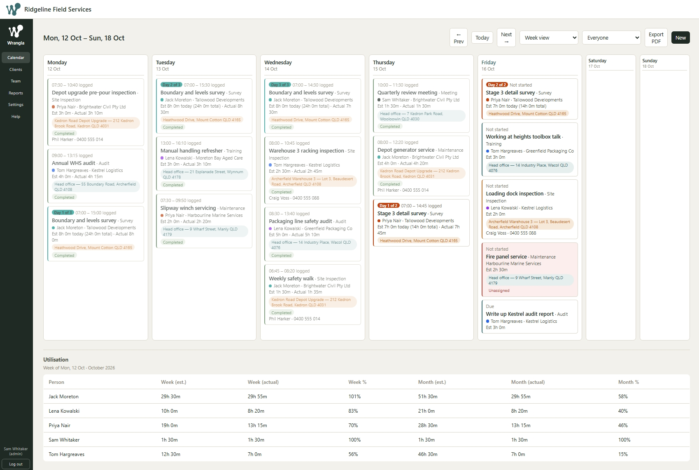
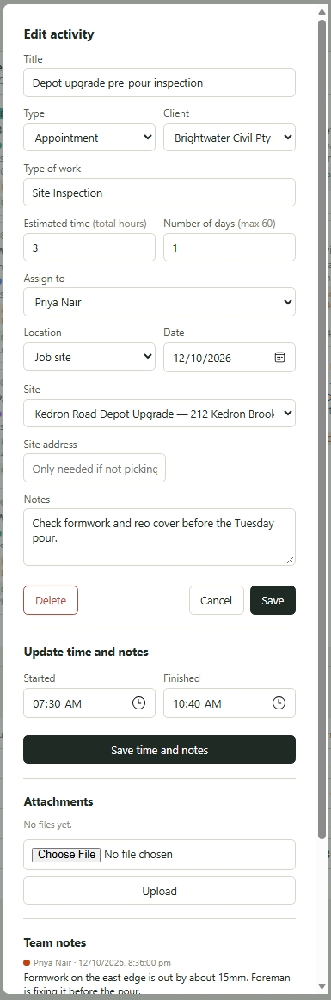
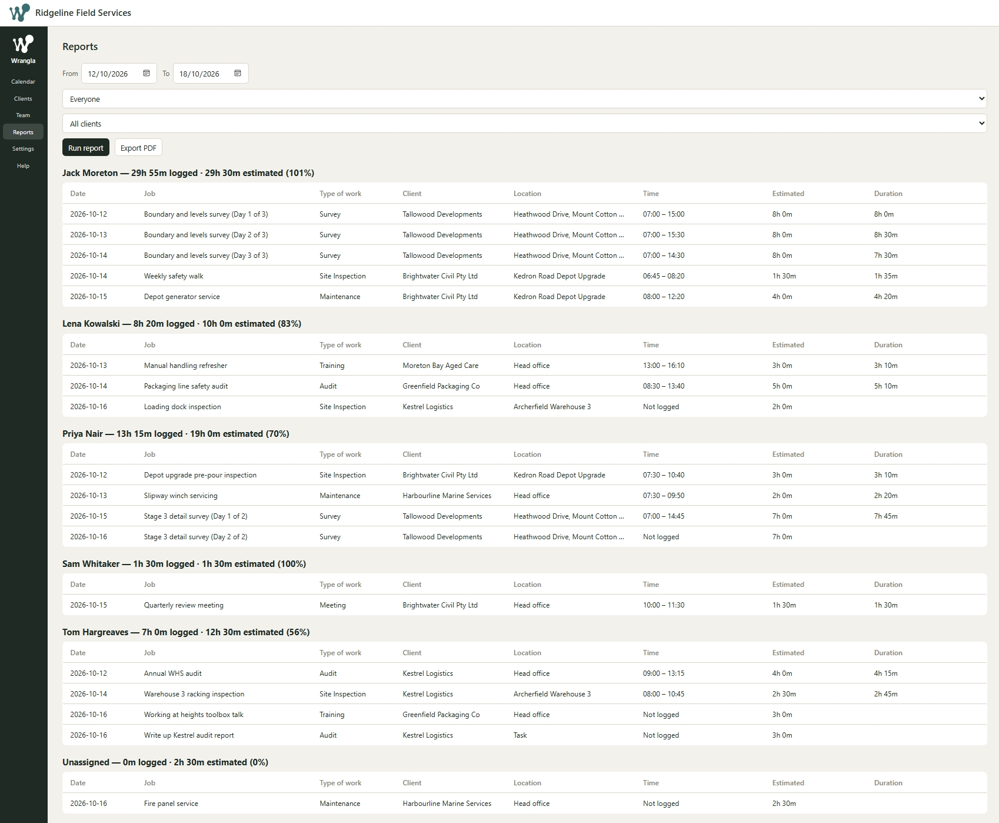
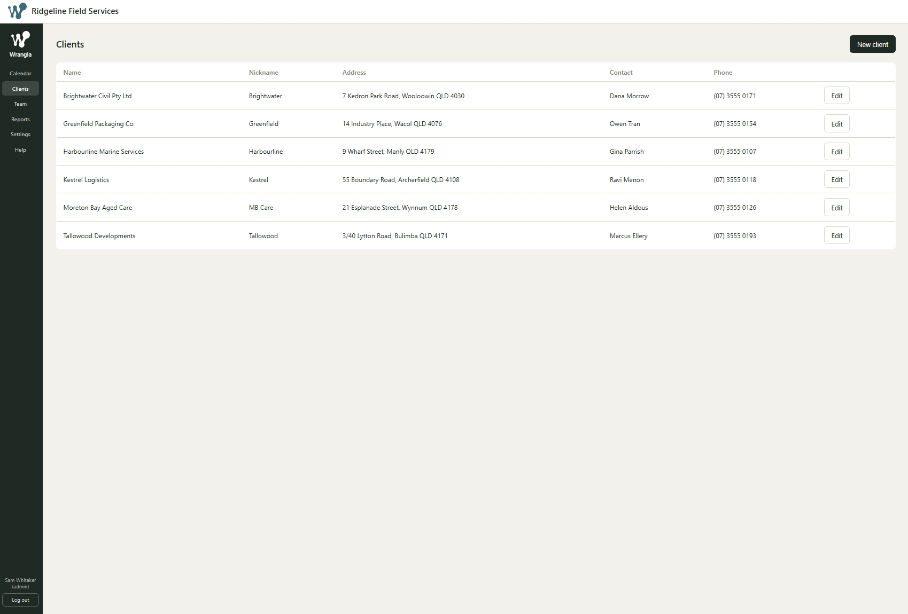
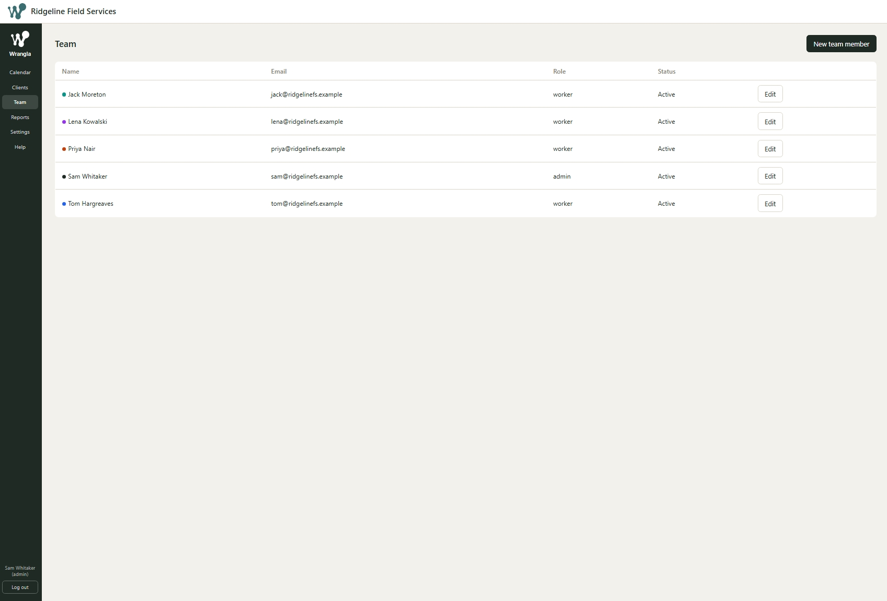
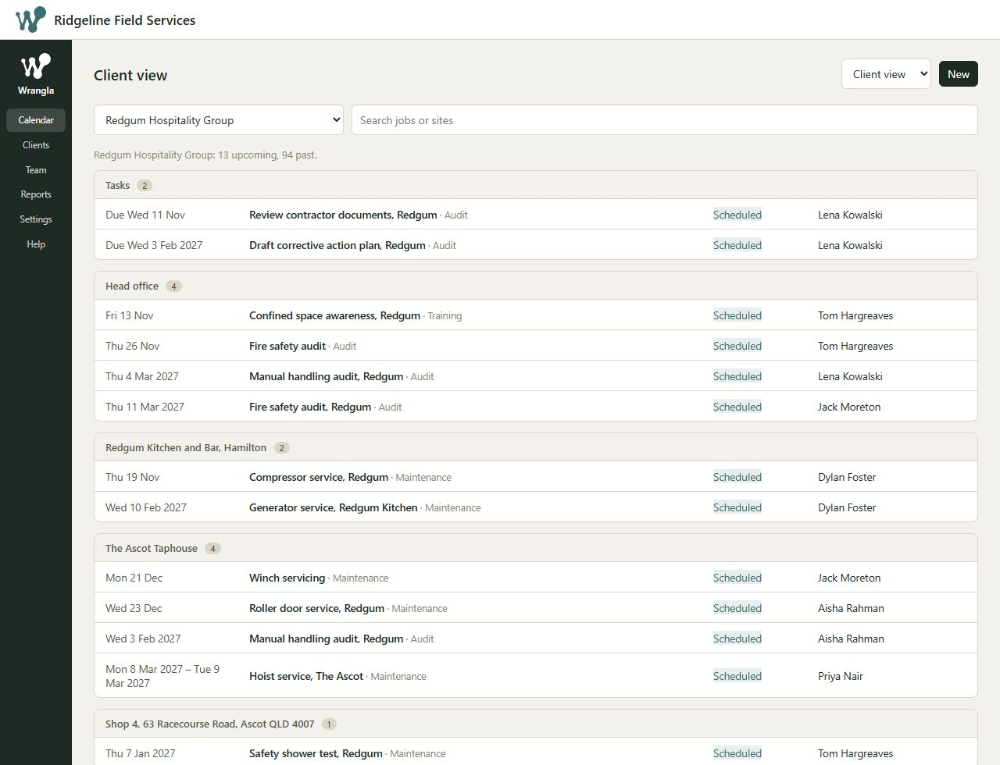

<p align="center">
  
</p>

# Wrangla

Wrangla is a scheduling app for small businesses that run on people and tasks: consultants, trades, field crews. Put jobs on a calendar, assign them to people, log the hours actually worked, and see estimate against actual. It runs entirely on Cloudflare (a Worker for the code, D1 for the database, R2 for uploaded files), so there is no server to look after and no PC that has to stay on. At small-team scale it fits inside Cloudflare's free allowances.

Each company that deploys it gets its own copy, with its own logo, details and colours.

[](https://deploy.workers.cloudflare.com/?url=https://github.com/max-christensen/wrangla) <a href="https://testbox.max-christensen.workers.dev"></a>

**Using the button:** it creates the Worker, the D1 database and the R2 bucket from `wrangler.toml`, and the deploy script loads the database tables for you (it runs [schema.sql](schema.sql), which is safe to run on every deploy). Nothing to run afterwards.

The button needs nothing typed in. **Open your Worker's address straight after it deploys and create the admin account** (see [First run](#first-run)). Until an admin exists, the first person to open the setup screen becomes the admin, so don't leave it. For extra protection, see [Optional secrets](#optional-secrets).

Want to look around first? Click **Try it live** above, then "Try the demo". It signs you in as a read-only viewer on a made-up company, so you can click through the calendar, clients, team and reports, but nothing can be changed.

Prefer to do everything by hand? Follow [Set it up](#set-it-up).

## Screenshots

Here's what Wrangla looks like with some made-up data for a small field services company. The week view is the home screen: every job is a card, colour-coded by who's doing it, with the estimated and logged hours underneath and a utilisation table for the whole team.



<table>
  <tr>
    <td width="50%" valign="top">
      
      <br>Open any job to change it, log the real start and finish times, or add notes.
    </td>
    <td width="50%" valign="top">
      
      <br>Reports total up the hours by person and client, ready for invoicing.
    </td>
  </tr>
  <tr>
    <td width="50%" valign="top">
      
      <br>Keep your clients and their job sites in one place.
    </td>
    <td width="50%" valign="top">
      
      <br>Add your team and give each person their own calendar colour.
    </td>
  </tr>
</table>

The Client view lists one client's jobs grouped by job site, upcoming first, with the past ones tucked away underneath.



## What it does

- **Calendar** with week and month views, weekends shrunk, client nicknames and estimate/real-hours badges on each job.
- **Client view**: pick a client (or see them all) and get their jobs as a list grouped by job site, upcoming first, with past jobs tucked away and a search box.
- **Appointments and tasks**, at head office or at a client's job site, assigned to a person or left unassigned (shown in red).
- **Multi-day jobs** that show as "Day 2 of 3" on each day, with an option to skip weekends.
- **Recurring jobs** (weekly, fortnightly, monthly) and **drag to another day** for admins.
- **Time logging per day**, reports by person and client, a utilisation panel, and PDF export through the print dialog.
- **Notes and attachments** (photos, PDFs) on every job.
- **Company branding**: name, address, registration number, logo and colours, set from a Settings screen.
- **Optional two-factor login**: password, then a 6-digit code emailed through [Resend](https://resend.com).
- Workers on a phone get a plain list of their own jobs.
- **Read-only Viewer accounts** that can see everything an admin sees but change nothing, plus an optional one-click demo login.

## What you need

- A free [Cloudflare account](https://dash.cloudflare.com/sign-up). R2 (file storage) has to be switched on in the dashboard under **R2 Object Storage**, and Cloudflare may ask for a payment method to enable it. Usage at this scale stays inside the free allowance.
- [Node.js](https://nodejs.org) 20 or newer.
- Optional, for two-factor login: a [Resend](https://resend.com) account and a domain you control. See [Two-factor login](#two-factor-login-optional).

## Set it up

Everything below runs from a terminal in the project folder.

1. **Get the code and install the tools**
   ```
   git clone <this repository's URL> wrangla
   cd wrangla
   npm install
   npx wrangler login
   ```
   `wrangler login` opens a browser so the Wrangler command line tool can use your Cloudflare account.

2. **Create the database**
   ```
   npx wrangler d1 create wrangla-db
   ```
   This prints a `database_id`. Open [wrangler.toml](wrangler.toml) and replace `REPLACE_WITH_YOUR_DATABASE_ID` with it. (If Wrangler offers to add the binding to your config for you, you can say yes, but check that the `database_name` is still `wrangla-db`.)

3. **Create the file storage bucket** (for attachments and your logo)
   ```
   npx wrangler r2 bucket create wrangla-attachments
   ```
   The name already matches `wrangler.toml`.

4. **Deploy**
   ```
   npm run deploy
   ```
   This first loads the database tables from [schema.sql](schema.sql) into your D1 database (safe to repeat), then deploys the Worker. Wrangler prints your address, something like `https://wrangla.<your-subdomain>.workers.dev`.

5. **Optional: set secrets** for extra protection. See [Optional secrets](#optional-secrets). If you want a setup key, set it before you open the app for the first time.

## First run

1. Open your address. On the login screen click **First time setting this up? Create the admin account**.
2. Enter your name, email and a password (8 or more characters). If you set a `SETUP_KEY` secret, the form also asks for it. This only works once; after the first admin exists it is disabled.
3. You land on **Settings**. Enter your company name, address, phone, email and ABN or other registration number, upload your logo, and choose your colours. These show in the header, on the login screen and on printed reports. Your logo is shown next to your company name; until you upload one, the header shows the Wrangla W in its place. You can change everything later from the Settings tab.
4. Go to **Team** and add each person with a name, email, starting password, role (Worker, Admin or Viewer) and calendar colour. A Viewer can look at everything but can't save any change, which suits an accountant or a manager who only wants to look.
5. Go to **Clients** and add your clients and their job sites, then start scheduling from **Calendar**.

The in-app **Help** page explains each screen in plain language.

## Optional secrets

Wrangla works with no secrets set. Two optional ones add protection:

- **`SETUP_KEY`**: a one-time password you choose. When set, creating the first admin needs it, so nobody else can claim the admin account if they find your address first. Set it before you first open the app.
- **`SESSION_SECRET`**: a long random string that signs login sessions, for example from `openssl rand -hex 32`. When it isn't set, Wrangla generates a random key on first use and stores it in your database; sessions are equally secure, but the key lives in the database. Setting your own keeps it out of the database and lets you rotate it. Setting or changing it logs everyone out once.

Set them with the Wrangler tool, or in the Cloudflare dashboard under **Workers & Pages → wrangla → Settings → Variables and Secrets** (as secrets):
```
npx wrangler secret put SETUP_KEY
npx wrangler secret put SESSION_SECRET
```

## Read-only demo login (optional)

To let people look around without being able to change anything, add a team member with the role **Viewer (read-only)** and set a plain variable called `DEMO_LOGIN_EMAIL` to that person's email address (in the Cloudflare dashboard under **Settings → Variables and Secrets**, or `[vars]` in `wrangler.toml`). The login screen then shows a short line saying it's a read-only demo and a **Try the demo** button. The button signs in with the password `demo1234`, so give the viewer that password, and only do this on a copy that holds nothing private. A demo viewer also skips the emailed code. When the variable isn't set, nothing changes. The live demo linked at the top of this page is run exactly this way.

## Two-factor login (optional)

When a Resend API key is present, logging in is a two-step process: the person enters their password, then a 6-digit code is emailed to them. The code is valid for about 10 minutes and allows 5 wrong guesses. A wrong password never reaches the code step. After the code, a session lasts 30 days, so the code is asked for roughly once a month per person per device. Only a hash of each code is stored.

Without a key, password login alone is used, so an install with no email set up still works.

To switch it on:

1. Create a Resend account and an API key with sending access.
2. In Resend, **add and verify a domain** you control (it gives you DNS records to add). Until a domain is verified, Resend only delivers to your own Resend account address, which is fine for a quick test but not for a team. **Every deployer needs their own Resend account and domain.**
3. In [wrangler.toml](wrangler.toml), change `MAIL_FROM` under `[vars]` to an address on that domain, for example `"Acme Scheduling <login@yourdomain.com>"`.
4. Store the key as a secret, then redeploy so `MAIL_FROM` takes effect:
   ```
   npx wrangler secret put RESEND_API_KEY
   npm run deploy
   ```
5. Test by logging in as an admin in a private window.

Admins can switch the code step off and on in **Settings → Sign-in security** (it is on by default once the key exists).

**If the code email stops working and you are locked out**, remove the key so password login takes over, then fix your Resend setup:
```
npx wrangler secret delete RESEND_API_KEY
```

## Running it locally

```
cp .dev.vars.example .dev.vars     # optional: it works with no secrets, so you can skip this
npm run db:init:local
npm run dev
```
The app is then at http://localhost:8787. Local data, including uploaded files, is kept in the `.wrangler/` folder, which is git-ignored. `.dev.vars` holds your local secrets and is also git-ignored; never commit it.

## Updating

When you change the code, or pull a newer version, redeploy:
```
npm run deploy
```
There is no downtime and no server to restart. If a newer version changes the database tables, its release notes will say what to run.

To keep a backup of your data: `npx wrangler d1 export wrangla-db --remote --output=backup.sql`.

## A note on naming: "job sites" vs `project_site`

In the app, a client's locations are called **job sites**. The database and code still use the older name `project_sites` (the table) and `project_site` (a value of `appointments.location_type`). That is deliberate: the change was wording only, so no migration was needed. If you are reading the code and see `project_site`, it means "job site".

## Notes for contributors

- The Worker is [src/index.js](src/index.js); the whole front end is [public/index.html](public/index.html), with the help page in [public/help.html](public/help.html). There is no build step.
- **Dates in the browser must be built from the local year, month and day, never from `toISOString()`**, or users east of UTC see everything a day early. Use the `fmtDate` helper. The Worker does its date arithmetic in UTC on `YYYY-MM-DD` strings, which is safe.
- An item's days are worked out by `itemDates()` in the Worker, which also decides weekend skipping. The browser reads the resulting `dates` list rather than recomputing it.
- `schema.sql` runs on every deploy, so it must stay re-runnable: use `CREATE ... IF NOT EXISTS` and `INSERT OR IGNORE`. It never alters a table that already exists, so changing an existing table needs a separate migration.
- Hours live in `time_entries` (one row per person per day, per item). People on an item live in `item_people`.

## Cost

At the size Wrangla is built for, a handful of workers and a few dozen clients, it runs on Cloudflare's free plans and should not cost anything. Here are the free limits as they stand at the time of writing, though Cloudflare can change them whenever it likes. The Worker, which runs the app's code, gets 100,000 requests a day. The database (D1) gets 5 million row reads a day, 100,000 row writes a day and 5 GB of storage. File storage (R2) gets 10 GB of storage, 1 million writes and 10 million reads a month, with no charge for downloads. A small team using the calendar all day stays far below all of these.

If a daily limit is ever reached, the app simply shows errors until the limits reset at midnight UTC (10am Brisbane time), and it does not start charging. R2 may ask for a payment method before you can switch it on, even though your usage stays inside the free allowance, as mentioned in [What you need](#what-you-need).

Resend, if you use it, has a free tier. Check the current limits on each provider's pricing page, including Cloudflare's for [Workers](https://developers.cloudflare.com/workers/platform/pricing/), [D1](https://developers.cloudflare.com/d1/platform/pricing/) and [R2](https://developers.cloudflare.com/r2/pricing/).

## Licence

[MIT](LICENSE).
